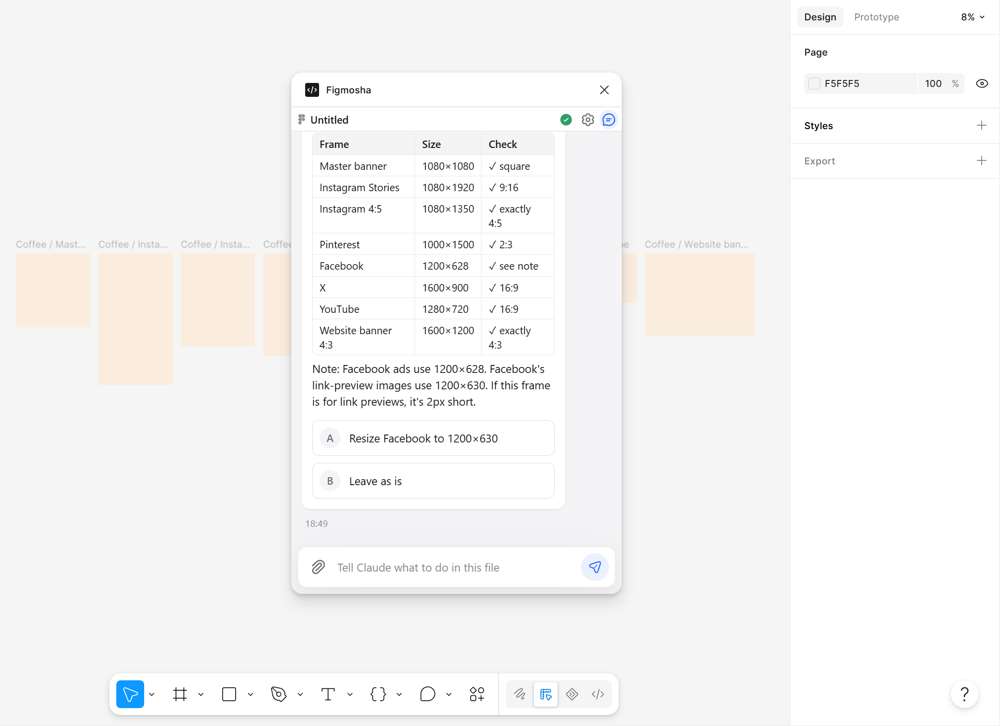
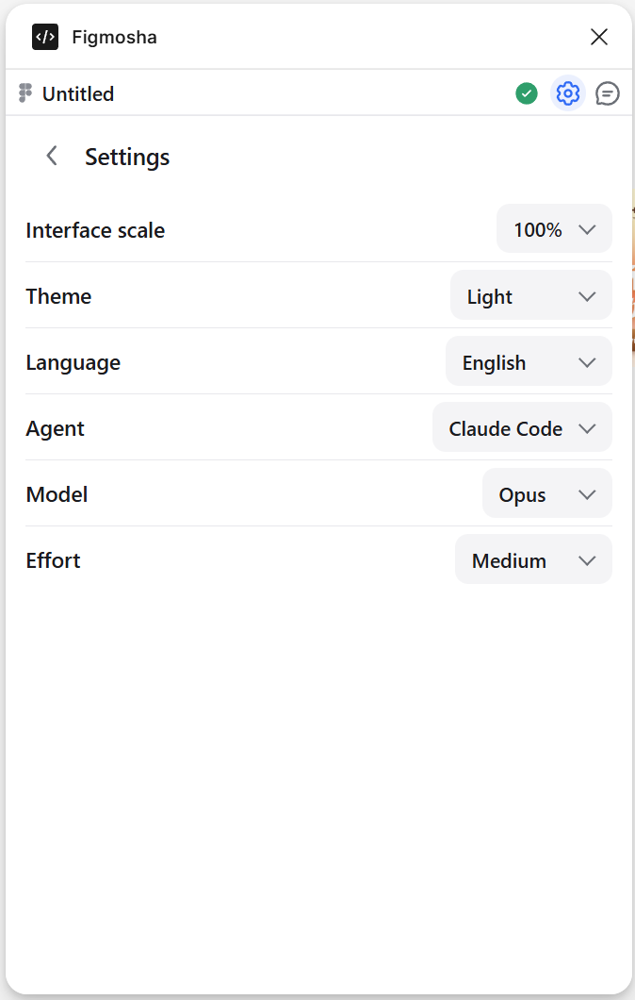
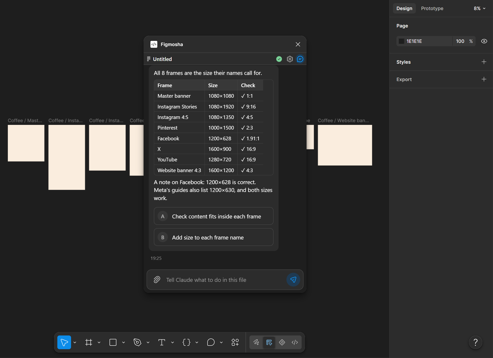
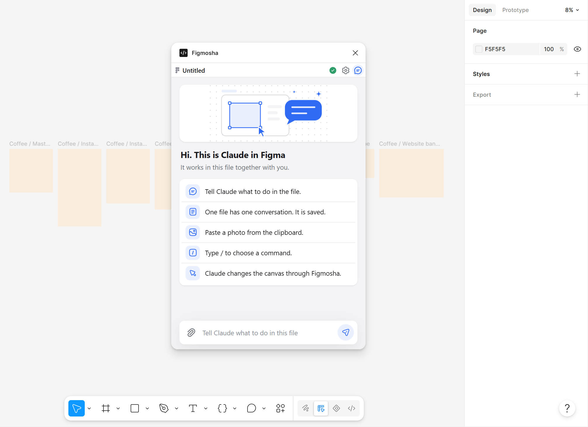

# Figmosha

Figmosha puts an AI chat inside Figma. You write what you want in plain words.
Claude Code or Codex does the work in your open file, and you see the result on
the canvas.

Figmosha is a small Figma plugin and a small program on your computer. It uses
your own Claude Code or Codex login. It adds no new account.



## What you can do

Talk to the agent about the file that is open. For example:

- List the frames on this page with their sizes.
- Rename all layers in this frame to clear names.
- Make three variants of this button: default, hover and disabled.
- Bind the colors and the spacing of this card to our variables.
- Replace the text in these cards with the texts from this list.
- Find every text that uses the wrong font.

The agent reads the file, changes it and tells you what it did. You can:

- **See the answer live.** The text comes in while the agent writes it. A short
  line shows the current step. The stop button stops the task.
- **Add images.** Use the clip button, or paste an image from the clipboard.
- **Quote a message.** Reply to an earlier message in the chat.
- **Click a next step.** The agent can show up to four buttons, A to D. One
  click sends that choice.
- **Answer questions.** The agent can ask questions. Each question has its own
  answer field.
- **Use commands.** Type `/` to see the commands. `/clear` starts a new
  conversation in the same file.

Each Figma file has its own conversation. The conversation is saved. It comes
back when you open the plugin again.

## What you need

- **Figma Desktop.** The browser version of Figma cannot run this plugin.
  [Download Figma Desktop](https://www.figma.com/downloads/).
- **Claude Code or Codex.** Install one of them and log in to it once in a
  terminal. Figmosha uses your own subscription.
- **Python 3.10 or newer.**
- **A computer with macOS, Windows or Linux.**

## Install

The easy way: ask your agent to install Figmosha for you.

1. Open Claude Code or Codex in a terminal.
2. Send this message:

   ```
   Set up Figmosha for me: https://github.com/denysosadchyi/figmosha2
   ```

   The agent downloads Figmosha and starts it. Then it tells you what to click
   in Figma.
3. In Figma Desktop, open **Plugins → Development → Import plugin from
   manifest…** and select the file `plugin/manifest.json` in the Figmosha
   folder. You do this only once.
4. Open **Plugins → Development → Figmosha**. The status icon turns green.
   Figmosha is ready.

<details>
<summary>Install without an agent</summary>

Type these commands in a terminal.

macOS or Linux:

```bash
git clone https://github.com/denysosadchyi/figmosha2.git
cd figmosha2
python3 -m venv venv && ./venv/bin/pip install -r requirements.txt
bash start-bridge.sh
```

Windows (PowerShell):

```powershell
git clone https://github.com/denysosadchyi/figmosha2.git
cd figmosha2
python -m venv venv; .\venv\Scripts\pip install -r requirements.txt
.\start-bridge.ps1
```

Then do steps 3 and 4 above.

</details>

## How to use

### Open the plugin

Open **Plugins → Development → Figmosha** in your file. To open it again
quickly, press **⌘⌥P** on a Mac or **Ctrl+Alt+P** on Windows.

The plugin has two views:

- **The bar** is a thin strip with the file name and a status icon.
- **The chat** is the full window.

The chat icon on the bar switches between the two views. The plugin opens in
the view you used last.

The status icon shows the state:

- **Green:** connected.
- **Grey:** connecting.
- **Amber:** a task runs in the file.
- **Red:** an error. Move the pointer over the icon to read it.
- **Blue:** a new version is ready, or the plugin must run again.

### Chat

Type your request in the field at the bottom and press Enter. You can send a
new message while the agent works. It waits and goes next.

To make the chat window bigger or smaller, drag any edge or corner. The chat
remembers its size and its place on the screen.

### Settings



Click the gear icon next to the chat icon to open the settings.

- **Interface scale:** 90, 100, 110 or 125 percent.
- **Theme:** Like Figma, Light or Dark. Like Figma uses the same theme as Figma.
- **Language:** English or Українська (Ukrainian). The plugin texts change at
  once. The agent answers in this language from your next message.
- **Agent:** Claude Code or Codex. You can select only an agent that is
  installed on your computer.
- **Model:** the models of the selected agent.
- **Effort:** how hard the agent thinks. More effort is slower. The default is
  Opus with medium effort.

The settings apply to all your files.



### Welcome screen



The first time you open the plugin in a file, you see a welcome screen. It
shows what the agent can do in this file. Type your first request in the
field, or press Esc to go to the chat. Each new file shows this screen once.

### First launch

The very first time you run the plugin, you see four short steps: what
Figmosha does, the language, the theme and the scale. You see these steps only
once. You can change each choice later in the settings.

### Good to know

- The agent does not ask before it runs a command or changes a file on your
  computer. Use Figmosha only on a computer where this is safe for you.
- Figmosha works only in a file where the plugin is open.
- Figma Desktop must stay open. A minimized Figma window is fine.
- The program on your computer stops when the computer restarts. Start it
  again after a restart (see [Problems and fixes](#problems-and-fixes)).

## How to update

Figmosha updates itself in the background. It checks for a new version every
6 hours. It installs the new version and restarts by itself, when no task runs.

When the plugin changed too, the chat asks you to restart the plugin one time.
Click **Restart** on the card in the chat, or run the plugin again
(**⌘⌥P** or **Ctrl+Alt+P**). There is nothing else to do.

If the plugin menu still shows an old name, import `plugin/manifest.json`
again, as in [Install](#install) step 3.

## Problems and fixes

| What you see | What to do |
|---|---|
| The status icon stays grey, or the plugin says Reconnecting | Figmosha is not running on your computer. Start it: `bash start-bridge.sh` on macOS or Linux, `.\start-bridge.ps1` on Windows. The plugin connects again in about 2 seconds. |
| The chat says no agent was found | Install Claude Code or Codex. Log in to it once in a terminal. Then click **Check again** in the chat. |
| The chat says the agent is not logged in | Open a terminal. Type `claude`, then `/login`. For Codex, type `codex` and log in. |
| The chat says the subscription limit is used up | Wait until the time in the message. Or select another agent or model in the settings. |
| The bar says New version: re-run plugin | Run the plugin again (**⌘⌥P** or **Ctrl+Alt+P**), or click **Restart** on the card in the chat. |
| Figma cannot import the plugin | Use Figma Desktop, not Figma in the browser. |
| On Windows, `python` opens the Microsoft Store | Install Python from python.org. Select **Add to PATH** during the install. |
| On a Mac, `python: command not found` | Type `python3` instead of `python`. |

Ask your agent if the problem is not in this list. It can read the
[developer guide](docs/DEVELOPERS.md) and fix most problems.

---

For developers: the HTTP API, the command line, scripts and tests are in
[docs/DEVELOPERS.md](docs/DEVELOPERS.md). How the chat works inside is in
[docs/CHAT.md](docs/CHAT.md). All changes are in the
[CHANGELOG](CHANGELOG.md).

License: MIT.
